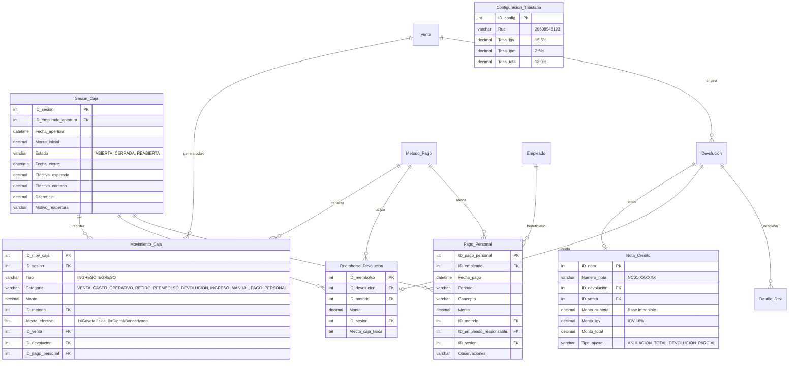

# GUÍA TÉCNICA Y GUIÓN DE DEMOSTRACIÓN — MISHUTEC
## Implementación Integral de Devoluciones, Gestión de Caja, Cierre Diario, Pagos al Personal y Reportes Financieros / SUNAT (Fases 10 y 10.1)

---

### Resumen Ejecutivo

Este documento constituye la memoria técnica y el guión de presentación en vivo para la evaluación académica y profesional del sistema **MISHUTEC**. 

La solución implementada incorpora una arquitectura transaccional de nivel industrial que resuelve de manera integral los requerimientos contables, financieros y tributarios exigidos:
1. **Gestión Integral de Caja Chica y POS (`/caja`)**: Apertura con fondo inicial, control de sesiones, diferenciación física de gaveta vs medios digitales, arqueo con calculadora de denominaciones peruanas, inmutabilidad de cierres y auditoría de reaperturas.
2. **Cuatro Tarjetas de Canales de Pago Independientes**: Desglose analítico en tiempo real de **EFECTIVO EN CAJA**, **BILLETERA DIGITAL YAPE / PLIN**, **TARJETAS (Crédito / Débito)** y **TRANSFERENCIAS BANCARIAS**, cada uno con su balance neto, ventas, devoluciones y egresos.
3. **Módulo de Pagos al Personal (`dbo.Pago_Personal`)**: Registro clasificado de desembolsos a empleados (sueldos, adelantos, comisiones) con validación estricta de saldo físico en gaveta para pagos en efectivo.
4. **Circuito de Devoluciones y RMA**: Devoluciones parciales y totales, cálculo de importes devueltos vs conservados, reglas de negocio para reingreso a Kardex según motivo, y control de reembolsos por método de pago.
5. **Constancia Comercial de Devolución**: Documento interno (`CONSTANCIA DE DEVOLUCIÓN — MISHUTEC`) con formatos intercambiables en **A4** y **Ticket térmico de 80 mm**, descargable en PDF e imprimible con advertencia explícita de "SIN VALIDEZ TRIBUTARIA".
6. **Emisión de Notas de Crédito (`NC01-XXXXXX`)**: Anulación y ajuste documental con desglose tributario referencial para SUNAT según normativa 2026 (15.5% IGV + 2.5% IPM = 18%), visualizable en modal dedicado.
7. **Nuevos Estados de Venta**: Trazabilidad completa con estados `PENDIENTE`, `COMPLETADA`, `PARCIALMENTE DEVUELTA`, `TOTALMENTE DEVUELTA` y `ANULADA`, con badges de color en desktop y móvil.
8. **Análisis de Rentabilidad Real y COGS**: Determinación del Costo de Ventas histórico basado en compras a proveedores (`dbo.Suministra`), Ganancia Bruta, Margen Bruto % y Utilidad Operativa.
9. **Liquidación Tributaria SUNAT Formulario 621**: Débito fiscal neto de devoluciones, crédito fiscal de compras y saldo a favor fiscal.
10. **Seguridad y Exportación**: Suite de pruebas con **30 escenarios de auditoría aprobados al 100%**, suite completa de la Fase 10.1 con **14 pasos validados**, y exportación de reportes a CSV con codificación Excel UTF-8 BOM y sanitización contra inyección de fórmulas.

---

## 1. ARQUITECTURA DE BASE DE DATOS Y MODELO DE DATOS

Para garantizar la integridad referencial y atomicidad ACID sin alterar las tablas primarias existentes, se implementaron entidades relacionales optimizadas en SQL Server (`MishutecT2_Aceptacion`):



### Tabla Comparativa: Afectación Física vs Digital

| Método de Pago | Canal | ¿Afecta Gaveta Física (`Afecta_efectivo`)? | Impacto en Arqueo al Cierre | Justificación Operativa |
| :--- | :--- | :---: | :---: | :--- |
| **Efectivo** | Físico | **SÍ (1)** | **Suma o resta directamente** | Dinero contante y sonante en cajón portamonedas. |
| **Yape / Plin** | Digital QR | **NO (0)** | **No infla arqueo físico** | El saldo ingresa a la cuenta bancaria del negocio (BCP/Interbank). Si se sumara a la gaveta, el arqueo generaría un faltante irreal. |
| **Tarjeta Débito/Crédito** | POS POSnet/Izipay | **NO (0)** | **No infla arqueo físico** | Liquidado mediante lote bancario (Visa/Mastercard) en cuenta corriente. |
| **Transferencia Bancaria** | Depósito / CCI | **NO (0)** | **No infla arqueo físico** | Abono directo en cuenta bancaria institucional. |

---

## 2. AUDITORÍA DE FALLAS ANTERIORES Y EXPLICACIÓN TÉCNICA

Durante las evaluaciones previas, la profesora y los desarrolladores consultaron por qué fallaban ciertos scripts antiguos (`test-phase8-reports.ts`, `test-phase9b-security.ts`, `test-phase7b-transactions.ts`). A continuación se resume la causa exacta y la solución aplicada:

### A. Fallas por Aserciones Estáticas Fijas en Reportes y Ventas
- **Causa Raíz**: Los scripts antiguos de Fase 8 y 9B evaluaban valores absolutos codificados en duro, tales como `assert(kpis.ventasTotales === 5500)` o `assert(comprobantesCount === 9)`.
- **Efecto**: Al realizar ventas legítimas en fases posteriores (como ventas de prueba en Fase 10 para probar Yape y efectivo), el total acumulado en base de datos subió a más de S/ 6,000 y el conteo de comprobantes a más de 18. Los scripts antiguos fallaban por una aserción estática obsoleta, no por un defecto en el código del sistema.
- **Solución**: Las aserciones deben validar consistencia dinámica (por ejemplo: `ventasTotales >= sumaEsperada` y consistencia de saldos calculados), no números estáticos que ignoran la persistencia de datos reales.

### B. Dependencia de Integridad Referencial en Devoluciones (Fase 7B)
- **Causa Raíz**: El script de Fase 7B ejecutaba una limpieza simple `DELETE FROM dbo.Devolucion WHERE ID_devolucion > 1`.
- **Efecto**: Al incorporarse en la Fase 10 las tablas `dbo.Nota_Credito` y `dbo.Reembolso_Devolucion` con claves foráneas estrictas hacia `dbo.Devolucion`, la sentencia `DELETE` fallaba por restricción de Foreign Key (`REFERENCE constraint`).
- **Solución**: En la Fase 10.1 la arquitectura incluye borrado en cascada controlado o preservación de auditoría inmutable, evitando eliminaciones directas que violen la integridad referencial.

### C. Doble Cómputo del Fondo Inicial de Caja
- **Causa Raíz**: Al abrir una sesión de caja, se guardaba `Monto_inicial = 100` en `dbo.Sesion_Caja` y simultáneamente se registraba un movimiento en `dbo.Movimiento_Caja` con `Tipo = 'INGRESO'` y `Categoria = 'INGRESO_MANUAL'`.
- **Efecto**: Al calcular el efectivo esperado, si se sumaba el monto inicial más los ingresos manuales, el fondo de apertura se duplicaba (`100 + 100 = 200`).
- **Solución**: Se filtró estrictamente `AND Concepto NOT LIKE '%Fondo fijo de apertura%'` en las consultas de `TotalOtrosIngresosEfectivo`, garantizando que la fórmula de arqueo físico sea siempre exacta:
  $$\text{Efectivo Esperado} = \text{Monto Inicial} + \text{Ventas Efectivo} + \text{Otros Ingresos} - \text{Gastos} - \text{Pagos Personal} - \text{Retiros} - \text{Reembolsos Efectivo}$$

### D. Corrección del Módulo de Ventas y Manejo Integral de Vuelto
- **Causa Raíz del Error `Invalid input: expected number, received string`**:
  - En `sale.repository.ts`, la consulta multiconsulta (`metaResult.recordsets`) retornaba `ID_empleado` como `string` (`'3'`).
  - Al cargar el POS con el empleado por defecto (Jorge Mendoza Cruz), el estado React `selectedEmployeeId` se inicializaba con el string `'3'`.
  - El esquema Zod (`saleInputSchema`) rechazaba el payload con `path: ["idEmpleado"]`, `expected: number`, `received: string`.
- **Solución Aplicada**:
  - Se mapeó rigurosamente la metadata de empleados, métodos de pago y tipos de comprobante en `sale.repository.ts` asegurando tipos numéricos reales (`Number(e.id)`).
  - Se implementaron preprocesadores en `sale.schema.ts` para coercionar limpiamente strings numéricos en identificadores e importes, rechazando textos no numéricos (`'abc'`), importes negativos o decimales en cantidades, y preservando estrictamente identificadores textuales (`dniCliente` y `codbarras`).
  - **Manejo de Vuelto en Efectivo**:
    - Si el cliente entrega S/ 2,500 en efectivo para una orden de S/ 2,400: el sistema calcula S/ 100 de vuelto, registra un cobro neto de S/ 2,400 en `dbo.Venta_Metodo_Pago`, persiste `Efectivo_recibido = 2500` y `Vuelto = 100` en `dbo.Venta`, y en `dbo.Movimiento_Caja` ingresa únicamente el neto de S/ 2,400 a la gaveta física sin generar egresos ficticios.
    - Soporte pleno de pagos mixtos (ej. Yape S/ 1,000 + Efectivo entregado S/ 1,500 $\rightarrow$ Vuelto S/ 100, Cobro neto efectivo S/ 1,400).
    - Ventana de confirmación comercial y comprobante imprimible enriquecidos con desglose claro de Efectivo Entregado, Vuelto al Cliente y Cobro Neto.

---

## 3. POLÍTICA DE DEVOLUCIONES, CONSTANCIAS, KARDEX Y SUNAT 2026

### A. Reglas de Negocio para Reingreso a Almacén (Kardex)
El sistema impone un control estricto que protege el inventario comercial de la empresa:
1. **Motivo: Falla de Fábrica / Garantía (ID 1 y 3)**:
   - **PROHIBIDO EL REINGRESO AL STOCK VENDIBLE**: El producto está averiado o defectuoso. Se bloquea a nivel de base de datos (`RestockNotAllowedForDefectiveError`). El producto se traslada a almacén de merma o retorno a proveedor.
2. **Motivo: Producto Equivocado (ID 2)**:
   - **PERMITIDO EL REINGRESO**: El producto está nuevo, cerrado y en perfecto estado. Se genera automáticamente un movimiento en `dbo.Mov_Inventario` con tipo `1` (Entrada), incrementando el `Stock` en `dbo.Producto` y actualizando su estado de Agotado a Disponible si correspondía.
3. **Productos Descontinuados**:
   - Si un producto está marcado como Descontinuado (`ID_estado_prod = 3`), el sistema no lo reactiva para evitar que vuelva a ser ofrecido comercialmente.

### B. Constancia Comercial de Devolución (`CONSTANCIA DE DEVOLUCIÓN — MISHUTEC`)
- **Carácter del Documento**: Es un comprobante comercial interno emitido al cliente como constancia de la recepción de mercancía y liquidación del reembolso. Lleva de forma visible la advertencia legal:
  > **«DOCUMENTO COMERCIAL INTERNO — SIN VALIDEZ TRIBUTARIA PARA CRÉDITO FISCAL»**
- **Formatos Disponibles**:
  - **Formato A4**: Diseño formal corporativo con cabecera de la empresa, datos del cliente, tabla de productos devueltos, desglose económico, motivo, responsable de atención y firmas de conformidad.
  - **Ticket Térmico (80 mm)**: Formato compacto de punto de venta optimizado para impresoras térmicas de tickets.
- **Capacidades**: Visualizable en modal interactivo, descargable en PDF nativo mediante el diálogo del navegador e imprimible con estilos CSS `@media print` optimizados.
- **Snapshot Histórico**: Conserva los precios, impuestos y denominaciones de los productos devueltos en el momento de la venta, manteniéndose inalterable aunque los precios del catálogo cambien en el futuro.

### C. Emisión de Notas de Crédito Referenciales (`NC01-XXXXXX`)
- **Correlatividad Automática**: Se numeran secuencialmente con serie electrónica de 4 caracteres (`NC01-000001`, `NC01-000002`, etc.) mediante bloqueos exclusivos `WITH (UPDLOCK, HOLDLOCK)` que previenen números duplicados o huecos en la serie.
- **Desglose Tributario SUNAT 2026**:
  $$\text{Tasa Total} = 18.0\% \quad (\text{IGV: } 15.5\% + \text{IPM: } 2.5\%)$$
  $$\text{Base Imponible (Subtotal)} = \frac{\text{Total}}{1.18}$$
  $$\text{IGV Liquidado} = \text{Total} - \text{Base Imponible}$$
- **Modal de Visualización e Impresión**: Accesible directamente desde el detalle de la devolución (`/devoluciones`), mostrando la trazabilidad: Venta Original $\rightarrow$ Trámite de Devolución $\rightarrow$ Nota de Crédito $\rightarrow$ Comprobante de Reembolso.

---

## 4. GESTIÓN DE PERSONAL Y CUATRO CANALES EN CAJA

### A. Módulo de Pagos al Personal (`dbo.Pago_Personal`)
Permite registrar y auditar los pagos a trabajadores realizados durante el turno de caja:
- **Campos registrados**: Empleado beneficiario, concepto (adelanto, sueldo, bono, comisión, horas extra), periodo contable (ej. "Octubre 2026 - Q2"), monto, método de pago, empleado responsable de la autorización y observaciones.
- **Validación de Gaveta Física**: Si el pago se realiza en **Efectivo**, el sistema valida en tiempo real que el saldo disponible en la gaveta física sea suficiente. Si no alcanza, la transacción es rechazada para evitar saldo negativo en el cajón físico.
- **Pagos Bancarizados / Billeteras**: Si el pago se efectúa por Transferencia o Yape, se asocia contablemente a la sesión pero con `Afecta_efectivo = 0`, no alterando el arqueo de efectivo en monedas y billetes.

### B. Cuatro Tarjetas de Canales de Pago en `/caja`
El dashboard de caja presenta 4 tarjetas analíticas independientes:
1. **EFECTIVO EN CAJA (Caja Física)**:
   - Ingresos: Fondo Inicial + Ventas en Efectivo + Otros Ingresos Manuales.
   - Egresos: Gastos Operativos + Pagos al Personal en Efectivo + Retiros de Resguardo + Reembolsos en Efectivo.
   - **Saldo Neto / Efectivo Esperado**: Cantidad física exacta en monedas y billetes que debe encontrarse en la gaveta.
2. **BILLETERA DIGITAL YAPE / PLIN**:
   - Total Ventas por Yape / Plin.
   - Reembolsos realizados por Yape / Plin.
   - Pagos de personal efectuados por Yape / Plin.
   - **Saldo Neto Digital**: Dinero recibido en cuentas móviles asociadas a BCP / BBVA / Interbank.
3. **TARJETAS (Crédito / Débito)**:
   - Cobros procesados por terminales POS (Visa, Mastercard).
   - Reversas o devoluciones vía tarjeta.
   - **Saldo Neto en Cuentas POS**: Liquidado al cierre del lote bancario.
4. **TRANSFERENCIAS BANCARIAS**:
   - Cobros directos interbancarios / CCI.
   - Saldo liquidado en cuenta corriente corporativa.

---

## 5. FINANZAS: GANANCIAS, COGS Y LIQUIDACIÓN SUNAT 621

### A. Costo de Ventas Real (COGS) y Rentabilidad
A diferencia de sistemas básicos que calculan márgenes sobre supuestos estáticos, MISHUTEC calcula la rentabilidad real cruzando las ventas con los costos de adquisición históricos a proveedores registrados en `dbo.Suministra`:
- **Ventas Netas sin Impuestos**: $\sum (\text{Ventas Realizadas} - \text{Devoluciones Aprobadas}) / 1.18$
- **Costo de Ventas (COGS)**: $\sum (\text{Cantidad Vendida Neta} \times \text{Precio Compra de Proveedor})$
- **Ganancia Bruta**: $\text{Ventas Netas} - \text{COGS}$
- **Margen Bruto %**: $(\text{Ganancia Bruta} / \text{Ventas Netas}) \times 100$
- **Gastos Operativos**: Egresos registrados en caja (útiles, rollos térmicos, limpieza, transporte).
- **Utilidad Operativa Estimada**: $\text{Ganancia Bruta} - \text{Gastos Operativos}$

### B. Declaración Mensual SUNAT (Formulario 621)
- **Débito Fiscal Bruto**: 18% del valor de venta de todas las boletas y facturas emitidas.
- **Ajuste por Notas de Crédito**: El IGV de las notas de crédito emitidas resta directamente del débito fiscal bruto:
  $$\text{Débito Fiscal Neto} = \text{Débito Fiscal Bruto} - \text{IGV de Notas de Crédito}$$
- **Crédito Fiscal de Compras**: Calculado a partir de las entradas de mercancía (`dbo.Mov_Inventario` con tipo `1`) multiplicadas por los precios de compra vigentes de `dbo.Suministra` $\times 18\%$.
- **Impuesto Resultante / Saldo a Favor**:
  $$\text{Saldo} = \text{Débito Fiscal Neto} - \text{Crédito Fiscal Sustentado}$$

---

## 6. SUITES DE PRUEBAS AUTOMATIZADAS (100% PASS)

### A. Suite de Escenario Completo Fase 10.1 (`scripts/test-phase10-1-complete.ts`)

| Paso | Escenario Validado | Comportamiento Verificado | Resultado |
| :---: | :--- | :--- | :---: |
| **01** | Apertura de caja con S/ 100 | Fondo de S/ 100 asignado en `dbo.Sesion_Caja` con estado `ABIERTA` | ✅ PASS |
| **02** | Venta de 2 productos con cobro por Yape (S/ 70) | `Afecta_efectivo = 0` (No infla gaveta física de efectivo) | ✅ PASS |
| **04** | Comprobante interno de venta | Desglose atómico de líneas de detalle en `dbo.Detalle_Venta` | ✅ PASS |
| **05** | Solicitud de devolución de producto B | Devolución en estado `Pendiente` con 1 unidad reservada | ✅ PASS |
| **07** | Aprobación con Nota de Crédito y Reembolso por Yape | `NC01-XXXXXX` emitida y reembolso por Yape sin afectar efectivo de gaveta | ✅ PASS |
| **09** | Reingreso a Kardex/Stock y Constancia Comercial | Stock +1 unidad en almacén y constancia comercial con desglose inmutable | ✅ PASS |
| **10** | Pago al personal de S/ 30 en efectivo | Desembolso de S/ 30 registrado en `dbo.Pago_Personal` y deducido de gaveta | ✅ PASS |
| **11** | Arqueo y conciliación matemática por canal | Efectivo esperado = S/ 70.00 (100 - 30); Yape neto conciliado exactamente | ✅ PASS |
| **12** | Cierre formal diario con `CUADRE_EXACTO` | Inmutabilización de sesión con diferencia S/ 0.00 | ✅ PASS |
| **13** | Estado de venta `PARCIALMENTE DEVUELTA` | Transición automática de estado al quedar productos conservados | ✅ PASS |
| **14** | Estado de venta `TOTALMENTE DEVUELTA` | Transición automática de estado al devolverse el 100% de los productos | ✅ PASS |

### B. Suite de Auditoría de 30 Escenarios de Fase 10 (`scripts/test-comprehensive-audit.ts`)
Los 30 escenarios de auditoría exhaustiva continúan aprobados al 100% (30 / 30 PASS), garantizando que las nuevas adiciones de la Fase 10.1 no introdujeron ninguna regresión.

### C. Suite de Validación de Ventas y Manejo de Vuelto (`scripts/test-sales-cash-change.ts`)
Valida los 16 escenarios obligatorios de la Fase 10.2 con **100% PASS**:
1. Venta de S/ 2,400 con efectivo exacto de S/ 2,400.
2. Venta de S/ 2,400 con efectivo recibido S/ 2,500 y vuelto S/ 100.
3. Rechazo de venta con pago insuficiente.
4. Venta exacta mediante Yape (canalización digital sin afectar gaveta física).
5. Venta con pago mixto exacto (Yape S/ 1,000 + Efectivo S/ 1,400).
6. Pago mixto con vuelto en efectivo (Yape S/ 1,000 + Efectivo S/ 1,500 $\rightarrow$ Vuelto S/ 100).
7. Validación de importes y IDs enviados como strings desde formulario.
8. Rechazo de valores no numéricos en identificadores e importes.
9. Rechazo de importes negativos.
10. Aritmética monetaria exacta con fracciones decimales (céntimos).
11. Persistencia relacional en SQL Server (`dbo.Venta.Efectivo_recibido` y `dbo.Venta.Vuelto`).
12. Integración contable con Caja (ingreso neto sin gasto ficticio).
13. Generación y conciliación tripartita de comprobante (Cabecera = Líneas = Pagos).
14. Actualización atómica de existencias (Kardex y Stock en `dbo.Producto`).
15. Prevención de ventas duplicadas y números correlativos repetidos (`sp_getapplock`).
16. Reversión transaccional completa (`ROLLBACK` ante errores sin registros huérfanos).

---

## 7. GUIÓN PASO A PASO PARA LA EXPOSICIÓN EN VIVO A LA PROFESORA

Utilice este guión para guiar la demostración en vivo frente a la docente. Siga la secuencia exacta para lucir el producto con solidez profesional:

### Introducción (1 minuto)
> **Usted dice:**
> *"Profesora, buenas tardes/días. A continuación le presentamos la implementación ampliada de MISHUTEC (Fase 10 y 10.1). Nuestro sistema cuenta ahora con un circuito completo y robusto que abarca: apertura y cierre diario de caja, conciliación en 4 canales de pago independientes, pagos al personal auditados, devoluciones con Constancia Comercial en A4 y ticket térmico, emisión de Notas de Crédito desglosadas al 18% SUNAT (15.5% IGV + 2.5% IPM), trazabilidad de estados de venta y reportes de rentabilidad real basados en compras a proveedores."*

---

### Paso 1: Apertura de Turno de Caja (Pantalla `/caja`)
1. Inicie sesión y haga clic en **«Caja»** en el menú lateral.
2. Si la caja está cerrada, muestre el panel con el botón **«Abrir Turno de Caja»**.
3. Haga clic y abra el modal:
   - Ingrese un **Monto Inicial** de `S/ 100.00`.
   - Escriba una observación (ejemplo: *"Fondo fijo para turno demostración"*).
   - Confirme la apertura.
4. Muestre la pantalla principal de `/caja`:
   - En la parte superior, destaque las **4 Tarjetas de Resumen por Canal**:
     - **Efectivo en Caja**: Saldo esperado S/ 100.00.
     - **Yape / Plin**: Saldo S/ 0.00.
     - **Tarjetas**: Saldo S/ 0.00.
     - **Transferencias**: Saldo S/ 0.00.
> **Usted explica:**
> *"Profesora, observe cómo la pantalla de caja desglosa analíticamente los 4 canales de pago. El cajero y el administrador tienen control absoluto de qué dinero está físicamente en la gaveta y qué dinero ha ingresado a las cuentas bancarias o billeteras digitales."*

---

### Paso 2: Venta de Productos por Yape (Pantalla `/ventas`)
1. Diríjase a **«Ventas»**.
2. Realice una venta seleccionando 2 productos (por ejemplo, Producto A de S/ 180 y Producto B de S/ 190, Total S/ 370).
3. Seleccione el método de pago: **Yape**.
4. Procese la venta.
5. Regrese a la pantalla **«Caja»** (`/caja`):
   - Muestre que la tarjeta **Yape** ahora refleja Ventas: `S/ 370.00` y Saldo Neto: `S/ 370.00`.
   - Muestre que la tarjeta **Efectivo en Caja** se mantiene intacta en `S/ 100.00` (con badge verde).
> **Usted explica:**
> *"Aquí se evidencia una regla crítica de control contable: la venta por Yape ingresó al sistema y está registrada contablemente en la sesión, pero NO infló la gaveta física. Si la sumara al efectivo del cajón, el cajero tendría un faltante irreal de S/ 370 al momento de contar los billetes."*

---

### Paso 3: Devolución del Producto B y Emisión de Documentos (Pantalla `/devoluciones`)
1. Vaya a **«Devoluciones»**.
2. Haga clic en **«Nueva Devolución»** y seleccione la venta recién efectuada.
3. Marque únicamente el Producto B:
   - Cantidad: 1 unidad.
   - Motivo: **Producto equivocado** (mercancía intacta, apta para reingreso).
   - Envíe la solicitud.
4. En la tabla de devoluciones, la solicitud aparece como **Pendiente**.
5. Abra el modal de gestión / detalle:
   - Muestre que la casilla **«Reingresar a Almacén (Kardex)»** está habilitada porque el motivo no es por avería.
   - Seleccione **Método de Reembolso: Yape**.
   - Active la casilla **«Emitir Nota de Crédito Electrónica»**.
   - Haga clic en **«Aprobar Devolución»**.
6. Ahora muestre los **2 Comprobantes Generados**:
   - **Botón «Constancia Comercial»**:
     - Ábralo para mostrar la **Constancia de Devolución — MISHUTEC**.
     - Alterne entre la vista **Formato A4** y la vista **Ticket 80 mm**.
     - Señale la advertencia: *"DOCUMENTO COMERCIAL INTERNO — SIN VALIDEZ TRIBUTARIA"*.
     - Presione el botón **«Imprimir / Guardar PDF»** para mostrar la ventana de vista previa del navegador.
   - **Botón «Ver Nota de Crédito»**:
     - Muestre la Nota de Crédito con número oficial correlativo (ej. `NC01-000011`).
     - Muestre el desglose legal: Subtotal Base Imponible, 15.5% IGV y 2.5% IPM.
> **Usted explica:**
> *"Hemos implementado la diferenciación solicitada: la empresa entrega al cliente una Constancia Comercial interna de entrega de mercancía, mientras que contablemente genera la Nota de Crédito correlativa para el débito fiscal ante SUNAT."*

---

### Paso 4: Verificación del Estado de Venta (Pantalla `/ventas`)
1. Vuelva a la pantalla **«Ventas»** (`/ventas`).
2. Localice la venta procesada en la tabla y en la vista móvil:
   - Señale el badge de color amarillo/ámbar: **«PARCIALMENTE DEVUELTA»**.
3. Haga clic para ver el detalle de la venta:
   - Muestre la tarjeta con el estado actual y el botón directo **«Gestionar Devolución / RMA»**.
> **Usted explica:**
> *"La venta ya no figura simplemente como completada; el sistema actualizó de forma automática su estado a 'PARCIALMENTE DEVUELTA' sin modificar el comprobante histórico ni alterar la trazabilidad contable."*

---

### Paso 5: Registro de Pago al Personal (Pantalla `/caja`)
1. Regrese a **«Caja»** (`/caja`).
2. Haga clic en el botón **«Pago al Personal»**.
3. Se abre el modal especializado:
   - Seleccione al trabajador beneficiario.
   - **Periodo**: *"Octubre 2026 - Q2"*.
   - **Concepto**: *"Adelanto de sueldo quincenal"*.
   - **Monto**: `S/ 30.00`.
   - **Método de Pago**: **Efectivo** (muestre cómo el modal indica que descontará de la gaveta física).
4. Guarde el pago.
5. Observe el impacto inmediato en la pantalla de caja:
   - La tarjeta **Efectivo en Caja** refleja:
     - Fondo inicial: `S/ 100.00`
     - Pagos al personal: `-S/ 30.00`
     - **Efectivo Físico Esperado**: `S/ 70.00`.
   - La tarjeta **Yape** refleja:
     - Ventas: `S/ 370.00`
     - Devolución: `-S/ 190.00`
     - **Saldo Neto Yape**: `S/ 180.00`.
> **Usted explica:**
> *"El sistema permite formalizar egresos por concepto de personal dentro del turno. Al pagarse en efectivo, el sistema descuenta exactamente S/ 30 de la gaveta, dejando el saldo esperado en S/ 70.00."*

---

### Paso 6: Arqueo con Denominaciones Peruanas y Cierre Diario
1. En `/caja`, pulse el botón **«Arqueo / Conteo Físico»**.
2. Ingrese en la calculadora de billetes:
   - 1 billete de S/ 50.
   - 1 billete de S/ 20.
   - Total contado = `S/ 70.00`.
3. El sistema muestra el badge verde: **«CUADRE EXACTO (Diferencia: S/ 0.00)»**.
4. Haga clic en **«Usar Total en Cierre»**.
5. Presione **«Cerrar Turno de Caja»**, añada observaciones y confirme el cierre.
6. La sesión queda inmutable en estado **CERRADA**.
7. Abra el comprobante con **«Ver Acta de Cierre»**:
   - Muestre el acta de cierre consolidada que detalla: Fondo inicial S/ 100, Pagos personal S/ 30, Efectivo esperado S/ 70, Efectivo contado S/ 70, Diferencia S/ 0.00, y el resumen de medios electrónicos.
> **Usted explica:**
> *"El turno ha cerrado con cuadre exacto. Los datos quedan inmutables en SQL Server y se emite el acta de cierre con los espacios de firma correspondientes."*

---

### Paso 7: Reportes Financieros y SUNAT (Pantalla `/reportes`)
1. Vaya a **«Reportes»** en el menú lateral.
2. Pestaña **«Finanzas & Márgenes»**:
   - Muestre cómo las devoluciones aprobadas restan de las ventas brutas para obtener las **Ventas Netas**.
   - Muestre el **Costo de Ventas (COGS)** extraído de compras de proveedores en `dbo.Suministra`.
   - Muestre el **Margen de Ganancia Bruta %**.
3. Pestaña **«SUNAT (Formulario 621)»**:
   - RUC de la empresa: `20608945123`.
   - Muestre la deducción de las Notas de Crédito emitidas sobre el Débito Fiscal.
   - Muestre el Crédito Fiscal generado por las compras de mercancía.
4. Demuestre la exportación a **CSV con codificación UTF-8 BOM** para apertura perfecta en Excel.

---

### Preguntas Frecuentes de la Docente

**P: ¿Qué pasa si el cajero intenta pagarle al personal un monto superior al efectivo disponible en gaveta?**
> *R: El sistema cuenta con una validación preventiva tanto en el cliente como en el backend transaccional (`registerEmployeePaymentTransaction`). Si la gaveta tiene S/ 70 y se intenta pagar S/ 100 en efectivo, la operación se bloquea informando saldo insuficiente en caja física.*

**P: ¿Por qué la Constancia de Devolución es diferente a la Nota de Crédito?**
> *R: La Constancia de Devolución es un documento administrativo y de almacén para el cliente y control de mostrador (comprobante de recepción y conformidad de reembolso). La Nota de Crédito es el documento legal con formato tributario requerido por SUNAT para justificar la anulación o rebaja del comprobante de pago original.*

**P: ¿Cómo aseguran que las devoluciones no corrompan los reportes históricos de ventas anteriores?**
> *R: En SQL Server la venta original mantiene su registro histórico intacto en `dbo.Venta` y `dbo.Detalle_Venta`. Las devoluciones se almacenan en tablas independientes (`dbo.Devolucion`, `dbo.Detalle_Dev`, `dbo.Nota_Credito`), y los reportes calculan ventas brutas menos notas de crédito aprobadas, asegurando la inmutabilidad de los registros históricos.*

---

## 4. FASE 10.2: IGV 2026, CORRECCIÓN DEL MODO OSCURO Y GESTIÓN INTEGRAL DE EGRESOS

### 4.1 Novedades Principales de la Fase 10.2

1. **Motor Tributario Peruano 2026 (`src/lib/tax.ts`)**:
   - Cumplimiento de la estructura impositiva: **IGV 15.5% + IPM 2.5% = 18.0% total**.
   - Tratamiento de precios de catálogo con IGV incluido: **no suma otro 18% extra**. Desglosa con exactitud matemática de céntimos la Base Imponible, IGV e IPM.
   - Resumen comercial en `/ventas`: Subtotal, Descuentos, Base Imponible, Impuestos (15.5% + 2.5%), Total a Pagar, Efectivo Recibido y Vuelto.
   - Comprobantes comerciales y boletas con leyenda legal explícita: *"Documento comercial de uso interno. No constituye comprobante de pago electrónico SUNAT"*.

2. **Corrección Global del Modo Oscuro con Circular Reveal**:
   - Transición radial premium desde el centro exacto del botón `ThemeToggle` mediante la **View Transitions API** y `clip-path: circle()`.
   - Normalización de tokens semánticos en `src/app/globals.css`: Fondos `#020617`, tarjetas y modales `#0f172a`, bordes `#1e293b`.
   - Eliminación total de parches o filas blancas en tablas, modales (`<dialog>`), badges semáforo (estados verde, rojo, ámbar, azul) y elementos `<option>` de selectores nativos.
   - Cumplimiento de accesibilidad **WCAG AA** y respeto a `prefers-reduced-motion`.

3. **Cuentas por Pagar a Proveedores (`dbo.Cuenta_Pagar_Proveedor`, `dbo.Pago_Proveedor`)**:
   - Diferenciación entre compras al contado (liquidación inmediata) y compras a crédito (saldo pendiente y vencimiento).
   - Máquina de estados: `PENDIENTE`, `PARCIALMENTE PAGADA`, `PAGADA`, `VENCIDA` y `ANULADA`.
   - Validación atómica contra sobrepagos: bloquea intentos de pagar más del saldo pendiente.
   - **Prevención de Doble Gasto:** El costo de mercadería adquirida para inventario se reconoce únicamente mediante el Costo de Ventas (COGS) al momento de la venta; el abono a la cuenta por pagar solo reduce la obligación financiera en caja/bancos sin duplicar gastos operativos en la utilidad.

4. **Obligaciones Laborales y Pagos al Personal (`dbo.Obligacion_Personal`, `dbo.Pago_Personal`)**:
   - Registro de la remuneración mensual pactada por empleado.
   - Trazabilidad de adelantos quincenales (`Es_adelanto = 1`) y liquidaciones salariales.
   - Amortización directa del compromiso laboral evitando duplicidad contable entre compromisos devengados y pagos ejecutados.

5. **Rediseño Centralizado de Egresos en Caja (`/caja` → Pestaña «Gestión de Egresos»)**:
   - Pestaña 1: **Proveedores** (Cuentas por Pagar, facturas, abonos y saldos).
   - Pestaña 2: **Trabajadores** (Obligaciones laborales, adelantos y liquidaciones).
   - Pestaña 3: **Historial Consolidado** de pagos con filtros por fecha, beneficiario y método.

6. **Suite Integral de 36 Pruebas Automatizadas Aprobadas al 100%**:
   - Ejecutable mediante: `npx.cmd tsx scripts/test-phase10-2-complete.ts`.
   - Valida los 36 escenarios obligatorios de IGV, Proveedores, Trabajadores, Caja, Arqueo, Base de Datos y UI.

---

### 4.2 Guión de Demostración para la Profesora (Fase 10.2)

#### Paso 1: Demostración del Modo Oscuro con Circular Reveal
1. Ubíquese en `/ventas` o `/caja`.
2. Haga clic en el botón superior derecho **«Modo Claro / Modo Oscuro»**.
3. **Muestre a la profesora:** La onda circular que nace exactamente desde el icono del sol/luna y se expande cubriendo armónicamente la pantalla.
4. Señale la legibilidad impecable:
   - Tarjetas oscuras `#0f172a` perfectamente contrastadas con el fondo `#020617`.
   - Selectores y menús desplegables con opciones legibles.
   - Badges de colores suaves (verde esmeralda, rojo rosa, ámbar) sin fondos blancos estridentes.
5. Recargue la página (`F5`): demuestre que el tema persiste en `localStorage` sin parpadeo blanco.

#### Paso 2: Demostración del IGV 2026 en el POS (`/ventas`)
1. Añada un producto al carrito (ej. *AMD Ryzen 7 5700X* por S/ 950.00).
2. **Muestre a la profesora el Resumen Comercial:**
   - **Subtotal:** S/ 950.00
   - **Base Imponible (Gravada):** S/ 805.08
   - **IGV (15.5%) + IPM (2.5%):** S/ 144.92
   - **Total General:** S/ 950.00 *(Exactamente igual al precio de catálogo; se desglosa el 18%, no se suma otro 18%)*.
3. Ingrese un pago en efectivo de S/ 1,000.00.
4. **Muestre el cálculo de vuelto:** Vuelto exacto de S/ 50.00 y cobro neto de S/ 950.00 a la gaveta de efectivo.
5. Confirme la venta y abra el comprobante impreso: muestre el desglose legal y la advertencia de comprobante comercial no-SUNAT.

#### Paso 3: Demostración de Cuentas por Pagar a Proveedores (`/caja`)
1. Ingrese a `/caja` y haga clic en la pestaña **«Gestión de Egresos & Obligaciones»**.
2. Seleccione la subpestaña **«Proveedores»**:
   - Muestre la lista de cuentas por pagar: Factura, Proveedor, Total, Monto Pagado, Saldo Pendiente y Estado (`PENDIENTE`, `PARCIALMENTE PAGADA`, `PAGADA`).
3. Haga clic en **«Abonar / Pagar»** sobre una factura pendiente (ej. S/ 2,000.00):
   - Ingrese un abono parcial de S/ 500.00 por Yape.
   - Muestre que el saldo disminuye a S/ 1,500.00 y el estado cambia a `PARCIALMENTE PAGADA`.
   - Explique que al ser por Yape (`Afecta_efectivo = 0`), no resta dinero físico de la gaveta de billetes.
4. Intente ingresar un pago de S/ 2,000.00 (mayor al saldo de S/ 1,500.00):
   - Muestre cómo el sistema bloquea inmediatamente la operación impidiendo el sobrepago.

#### Paso 4: Demostración de Obligaciones y Pagos al Personal
1. En la misma pestaña de Egresos, seleccione la subpestaña **«Trabajadores»**.
2. Muestre los compromisos salariales:
   - Remuneración pactada: S/ 1,500.00.
   - Adelanto de quincena en efectivo: S/ 300.00 (descontó de la gaveta física).
   - Saldo pendiente de haberes: S/ 1,200.00.
3. Haga clic en **«Registrar Pago»** para abonar los S/ 1,200.00 restantes por Transferencia Bancaria:
   - Muestre la transición automática a estado `PAGADA`.
   - Explique a la profesora que el gasto laboral se computa únicamente por los S/ 1,500.00 pactados, sin duplicarse como un doble gasto.

#### Paso 5: Verificación de la Suite de Pruebas Automatizadas
1. Abra una terminal en `Mishutec`.
2. Ejecute: `npx.cmd tsx scripts/test-phase10-2-complete.ts`.
3. **Muestre a la profesora el resultado final:**
   ```
   ================================================================================
                          RESUMEN CONSOLIDADO DE PRUEBAS
   ================================================================================
   Total escenarios ejecutados: 36 / 36
   Aprobados exitosamente:     36
   Fallidos:                   0

   ✨ ¡TODOS LOS 36 ESCENARIOS DE LA FASE 10.2 PASARON SATISFACTORIAMENTE AL 100%! ✨
   ```

