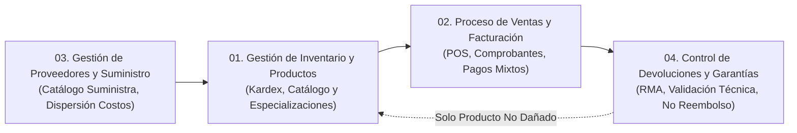

# INFORME TÉCNICO ACADÉMICO
## Sistema de Gestión Comercial, Inventarios y Facturación POS — MISHUTEC

**Proyecto:** MISHUTEC (Tienda de Componentes de Cómputo)  
**Curso:** Taller de Base de Datos / Ingeniería de Software y Sistemas  
**Motor de Base de Datos:** Microsoft SQL Server 2022 Express Edition  
**Stack Tecnológico Web:** Next.js 16 (App Router, Turbopack), TypeScript 5, Tailwind CSS 4, React 19  
**Driver de Conectividad:** `mssql` v12 con `msnodesqlv8` (Windows Integrated Authentication)  
**Fecha de Emisión:** Octubre de 2026  
**Versión del Documento:** 1.0 — Entrega Final y Sustentación  

---

## 1. RESUMEN EJECUTIVO (ABSTRACT)

El presente informe documenta el diseño, modelado, implementación y validación integral del sistema informático y la arquitectura de base de datos para la empresa comercial **Mishutec**, especializada en el abastecimiento, distribución y venta de hardware y componentes de cómputo para ensamblaje y actualización de equipos.

La solución integra un modelo de datos relacional de **25 tablas físicas** normalizadas en Tercera Forma Normal (3FN), gobernadas por integridad referencial estricta, restricciones declarativas de dominio (`CHECK`), claves foráneas compuestas y reglas de negocio automatizadas a nivel de motor SQL Server. Sobre esta base, se diseñó e implementó un sistema web empresarial desarrollado con **Next.js 16 App Router**, el cual proporciona interfaces de usuario ergonómicas, un punto de venta (POS) reactivo para caja, conciliación de pagos mixtos, control de existencias en tiempo real mediante Kardex formal, gestión postventa de devoluciones y garantías RMA con aislamiento de inventario averiado, y un centro de análisis comercial (Business Intelligence) con exportación segura de datos.

La auditoría del sistema certifica **73 de 73 escenarios de prueba de extremo a extremo (E2E) aprobados** en la Fase 9C, ratificando la absoluta integridad transaccional (ACID), blindaje de autenticación, mitigación de vulnerabilidades web (Open Redirect, Inyección SQL, CSV Formula Injection) y el respeto incondicional de los datos académicos protegidos en la base original `MishutecT2`.

---

## 2. REALIDAD PROBLEMÁTICA Y JUSTIFICACIÓN

### 2.1 Contexto Empresarial
Mishutec es una empresa del sector retail tecnológico orientada a la venta minorista y mayorista de hardware crítico: procesadores (CPU), memorias RAM, unidades de estado sólido (SSD), tarjetas gráficas (GPU), fuentes de poder y gabinetes para computadoras. Su público objetivo comprende desde entusiastas del ensamblaje y estudiantes de ingeniería hasta empresas corporativas de diseño y desarrollo de software.

### 2.2 Diagnóstico de la Situación Inicial
Antes de la adopción del sistema, la empresa experimentaba deficiencias estructurales comunes en el comercio retail tradicional:
1. **Control manual o desarticulado de inventarios:** Existencias desfasadas entre la bodega física y el registro de ventas, provocando roturas de stock o sobreventas de artículos de alta demanda.
2. **Dispersión en el proceso de facturación y cobro:** Incapacidad de consolidar ventas fraccionadas con múltiples medios de pago (efectivo combinado con tarjeta, billeteras digitales Yape o transferencias bancarias), generando inconsistencias en los arqueos de caja al final de la jornada.
3. **Pérdidas operativas por gestión deficiente de garantías:** Confusión crítica entre *reconocimiento de garantía comercial* y *reincorporación física de mercancía averiada al almacén*, lo que derivaba en volver a despachar piezas defectuosas a nuevos clientes.
4. **Falta de visibilidad directiva:** Ausencia de indicadores en tiempo real respecto al margen de comercialización de proveedores, rotación de familias de productos y productividad de los asesores de ventas.

### 2.3 Justificación del Proyecto
La construcción de un sistema relacional en Microsoft SQL Server interconectado a una arquitectura web moderna con Next.js 16 se justifica por la necesidad de garantizar **consistencia inmediata de datos**, transacciones ACID indivisibles para cobros y salidas de stock, y una trazabilidad completa de cada componente desde su ingreso por recepción de proveedor hasta su despacho comercial o eventual trámite postventa.

---

## 3. OBJETIVOS DEL SISTEMA

### 3.1 Objetivo General
Desarrollar e implementar un sistema de información transaccional integral y una base de datos relacional robusta en Microsoft SQL Server para optimizar la administración de catálogos, el control de existencias en almacén, la facturación comercial multi-pago y la gestión de garantías de la tienda de componentes de cómputo Mishutec.

### 3.2 Objetivos Específicos
1. **Modelar y normalizar** la estructura relacional de la base de datos hasta Tercera Forma Normal (3FN), consolidando 25 tablas físicas con especialización de hardware y relaciones muchos a muchos resueltas mediante tablas asociativas.
2. **Asegurar la integridad referencial y de dominio** a nivel de motor de base de datos mediante el empleo riguroso de restricciones `PRIMARY KEY`, `FOREIGN KEY`, `UNIQUE`, `CHECK` y valores `DEFAULT`.
3. **Automatizar el flujo transaccional de ventas (POS):** Garantizar la atomicidad en la emisión de comprobantes internos (Boletas y Facturas), el descuento automático de existencias físicas y el registro de pagos combinados mediante transacciones explícitas con aislamiento de concurrencia.
4. **Establecer una política de garantías y RMA controlada:** Administrar solicitudes de devolución con resolución técnica formal, protegiendo el stock comercial vendible mediante la custodia de piezas dañadas y el reingreso restrictivo vía Kardex únicamente para casos justificados de empaque íntegro.
5. **Proveer una suite de analítica y reportes gerenciales:** Visualizar KPIs de facturación, rotación de inventarios, márgenes de suministro y métricas postventa, ofreciendo exportaciones tabulares sanitizadas bajo normativas internacionales.
6. **Preservar el entorno académico original:** Mantener el aislamiento físico de la base de datos de evaluación académica (`MishutecT2`) frente al ambiente de pruebas y aceptación comercial (`MishutecT2_Aceptacion`).

---

## 4. ALCANCE Y PROCESOS DE NEGOCIO ABARCADOS

El sistema modela fielmente los cuatro procesos de negocio troncales especificados en el documento de propuesta original de Mishutec, complementados con módulos gerenciales de apoyo:

### Proceso 1: Gestión de Inventario y Productos
- **Entidades Motor:** `Producto`, `Categoria`, `Marca`, `Estado_Prod`, `CPU`, `RAM`, `SSD`, `Grafica`, `Fuente_Poder`, `Gabinete`, `Mov_Inventario`, `Tipo_Movimiento`.
- **Alcance Operativo:** Registro y mantenimiento de 12 referencias activas (10 académicas originales + 2 de aceptación). Especialización técnica de atributos según la familia de componente (frecuencia, núcleos, VRAM, potencia, interfaz). Control de stock no negativo (`CHECK Stock >= 0`) y auditoría secuencial de movimientos de almacén (`Entrada`, `Salida`, `Ajuste`) vinculados a empleados autorizados.

### Proceso 2: Ventas y Facturación Comercial
- **Entidades Motor:** `Venta`, `Detalle_Venta`, `Venta_Metodo_Pago`, `Tipo_Comprobante`, `Metodo_Pago`, `Cliente`, `Empleado`.
- **Alcance Operativo:** Punto de Venta (POS) en caja comercial con escaneo de código de barras (EAN-13). Asignación de cliente por DNI y cajero responsable. Emisión de comprobantes internos correlativos (Boletas serie `B001-XXXXXX` y Facturas serie `F001-XXXXXX`). Admisión de pagos mixtos fraccionados (Efectivo, Tarjeta, Transferencia, Yape). Conciliación financiera estricta: la suma de pagos registrados coincide al céntimo con el subtotal facturado. Descuento atómico de stock.

### Proceso 3: Proveedores y Suministro
- **Entidades Motor:** `Proveedor`, `Suministra`, `Producto`.
- **Alcance Operativo:** Resolución de la relación muchos a muchos ($M:N$) entre proveedores mayoristas y productos del catálogo. Cada tupla almacena el `Precio_compra` específico pactado con cada mayorista. Permite analizar la dispersión de costos de adquisición entre distintos proveedores (ej. Tecno Import Perú SAC vs Distribuidora Andina de Cómputo para memorias Kingston) y evaluar márgenes brutos de intermediación sin suponer órdenes de compra ausentes en el esquema físico.

### Proceso 4: Devoluciones y Garantías (RMA)
- **Entidades Motor:** `Devolucion`, `Detalle_Dev`, `Estado_Dev`, `Motivo_Dev`, `Detalle_Venta`, `Venta`.
- **Alcance Operativo:** Apertura de expedientes de garantía técnica vinculados a comprobantes de venta válidos. Evaluación de motivos catalogados (`Producto defectuoso`, `Producto equivocado`, `Garantía`). Estados del trámite (`Pendiente`, `Aprobada`, `Rechazada`). Aclaración legal y transaccional: el sistema **no emite notas de crédito ni desembolsos monetarios**; la aprobación formaliza el reconocimiento de la garantía. Si el producto presenta falla física irreversible, pasa a custodia técnica de descarte sin tocar el almacén vendible. Si la devolución obedece a un error de despacho con empaque sellado, se ejecuta un reingreso manual certificado en el Kardex.

---

## 5. RECONCILIACIÓN Y ESTADO DE LAS BASES DE DATOS

En cumplimiento de las directrices de auditoría académica, se mantiene la coexistencia de dos bases de datos en la instancia `DESKTOP-QV4VK5K\SQLEXPRESS`:

| Métrica Auditada | MishutecT2 (Base Académica Protegida) | MishutecT2_Aceptacion (Base de Pruebas Activa) | Justificación de la Variación |
|------------------|:-------------------------------------:|:----------------------------------------------:|--------------------------------|
| **Total de Tablas (`dbo`)** | 25 | 25 | Esquema 100% idéntico. |
| **Productos (SKUs)** | 10 | 12 | 2 SKUs adicionales añadidos en Fase 6B para pruebas de POS. |
| **Stock Físico Acumulado** | 73 unidades | 76 unidades | Variación neta por ventas y reingreso de Kardex. |
| **Ventas Realizadas** | 5 ventas | 9 ventas | 4 ventas transaccionales ejecutadas en Fase 6B. |
| **Monto Facturado** | S/ 4,050.00 | S/ 5,500.00 | S/ 1,450.00 generados por las 4 ventas de aceptación. |
| **Líneas de Detalle de Venta** | 8 detalles | 13 detalles | 5 líneas de detalle adicionales. |
| **Registros de Pago** | 6 pagos | 11 pagos | 5 pagos procesados (incluyendo pagos mixtos). |
| **Movimientos Kardex** | 17 movimientos | 31 movimientos | 13 salidas por venta + 1 entrada por RMA #52. |
| **Trámites de Devolución** | 1 trámite | 7 trámites | 6 trámites incorporados en Fases 7A y 7B. |
| **Líneas de Detalle de RMA** | 1 detalle | 8 detalles | 7 unidades reclamadas en aceptación. |

---

## 6. CONCLUSIÓN ACADÉMICA

El proyecto **Mishutec** demuestra con rigor metodológico cómo los principios teóricos de modelamiento de bases de datos relacionales (normalización, integridad referencial, álgebra relacional y transacciones ACID) se materializan con éxito en un entorno industrial real. La separación estricta entre la lógica de almacenamiento relacional en Microsoft SQL Server y la capa de presentación y orquestación en Next.js 16 garantiza un sistema robusto, auditable, escalable y preparado para su defensa y sustentación académica de fin de curso.
