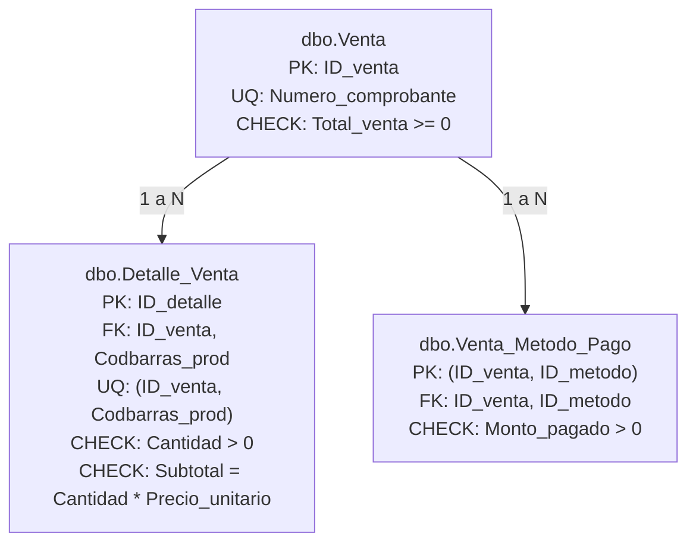

# MODELO ENTIDAD-RELACIÓN Y FUNDAMENTOS DEL MODELO RELACIONAL
## Arquitectura de Datos de MISHUTEC (25 Tablas Físicas en 3FN)

**Motor de Base de Datos:** Microsoft SQL Server 2022 Express  
**Esquema:** \`dbo\`  
**Nivel de Normalización:** Tercera Forma Normal (3FN) con integridad referencial declarativa completa.

---

## 1. DIAGRAMA ENTIDAD-RELACIÓN (ER) DEL SISTEMA COMPLETO

El siguiente diagrama modela fielmente las **25 entidades físicas** existentes en Microsoft SQL Server, sus claves primarias, claves foráneas, cardinalidades y dependencias operativas:

\`\`\`mermaid
erDiagram
    %% CATÁLOGOS MAESTROS
    MARCA ||--o{ PRODUCTO : "clasifica marca"
    CATEGORIA ||--o{ PRODUCTO : "clasifica categoria"
    ESTADO_PROD ||--o{ PRODUCTO : "determina condicion"
    TIPO_COMPROBANTE ||--o{ VENTA : "rige formato"
    METODO_PAGO ||--o{ VENTA_METODO_PAGO : "especifica medio"
    TIPO_MOVIMIENTO ||--o{ MOV_INVENTARIO : "tipifica movimiento"
    ESTADO_DEV ||--o{ DEVOLUCION : "controla estado"
    MOTIVO_DEV ||--o{ DETALLE_DEV : "justifica reclamo"

    %% PRODUCTO Y ESPECIALIZACIONES (HERENCIA 1:1)
    PRODUCTO ||--o| CPU : "especializa procesador"
    PRODUCTO ||--o| RAM : "especializa memoria"
    PRODUCTO ||--o| SSD : "especializa almacenamiento"
    PRODUCTO ||--o| GRAFICA : "especializa gpu"
    PRODUCTO ||--o| FUENTE_PODER : "especializa fuente"
    PRODUCTO ||--o| GABINETE : "especializa chasis"

    %% CADENA DE SUMINISTRO (RELACIÓN M:N)
    PRODUCTO ||--o{ SUMINISTRA : "es abastecido por"
    PROVEEDOR ||--o{ SUMINISTRA : "suministra a precio"

    %% PERSONAS
    CLIENTE ||--o{ VENTA : "compra mediante"
    EMPLEADO ||--o{ VENTA : "emite y atiende"
    EMPLEADO ||--o{ MOV_INVENTARIO : "registra movimiento"
    EMPLEADO ||--o{ DEVOLUCION : "evalua garantia"

    %% VENTAS, DETALLE Y PAGOS
    VENTA ||--|{ DETALLE_VENTA : "contiene lineas"
    PRODUCTO ||--o{ DETALLE_VENTA : "se despacha en"
    VENTA ||--|{ VENTA_METODO_PAGO : "se liquida con"

    %% INVENTARIO KARDEX
    PRODUCTO ||--o{ MOV_INVENTARIO : "audita existencias"

    %% DEVOLUCIONES Y GARANTÍAS (RMA)
    VENTA ||--o{ DEVOLUCION : "origina expediente"
    DEVOLUCION ||--|{ DETALLE_DEV : "detalla unidades"
    DETALLE_VENTA ||--o{ DETALLE_DEV : "hace referencia a linea"

    %% ESTRUCTURAS DETALLADAS
    PRODUCTO {
        string Codbarras_prod PK
        string Nombre_prod
        decimal Precio
        int Garantia_meses
        int Stock
        int ID_estado_prod FK
        int ID_categoria FK
        int ID_marca FK
    }

    VENTA {
        int ID_venta PK
        date Fecha_venta
        decimal Total_venta
        string Numero_comprobante UK
        int ID_tipo_comp FK
        string Dni_cliente FK
        int ID_empleado FK
    }

    DETALLE_VENTA {
        int ID_detalle PK
        int Cantidad
        decimal Precio_unitario
        decimal Subtotal
        int ID_venta FK
        string Codbarras_prod FK
    }

    VENTA_METODO_PAGO {
        int ID_venta PK,FK
        int ID_metodo PK,FK
        decimal Monto_pagado
    }

    SUMINISTRA {
        string Codbarras_prod PK,FK
        int ID_proveedor PK,FK
        decimal Precio_compra
    }

    MOV_INVENTARIO {
        int ID_movimiento PK
        date Fecha
        int Cantidad
        int ID_tipo_mov FK
        string Codbarras_prod FK
        int ID_empleado FK
    }

    DEVOLUCION {
        int ID_devolucion PK
        date Fecha_dev
        int ID_estado_dev FK
        int ID_venta FK
        int ID_empleado FK
    }

    DETALLE_DEV {
        int ID_detalle_dev PK
        int Cantidad_dev
        int ID_devolucion FK
        int ID_detalle FK
        int ID_motivo FK
    }
\`\`\`

---

## 2. FUNDAMENTOS Y PRINCIPIOS TEÓRICOS DEL MODELO RELACIONAL

### 2.1 Integridad Referencial
La integridad referencial garantiza que las relaciones entre tablas se mantengan formalmente consistentes en todo momento. En SQL Server, se implementa mediante restricciones \`FOREIGN KEY\` que impiden:
1. **Registros huérfanos:** No se puede insertar una venta para un cliente inexistente (\`FK_Venta_Cliente\`) ni asociar un movimiento Kardex a un código de barras inexistente (\`FK_Mov_Producto\`).
2. **Eliminaciones destructivas accidentales:** El motor rechaza la eliminación de un registro padre (ej. un registro en \`dbo.Categoria\`) si existen registros dependientes en \`dbo.Producto\`, a menos que se defina expresamente una política en cascada (desaconsejada en sistemas contables y comerciales).

### 2.2 Relaciones Uno a Muchos (1:N)
Constituyen el tipo de asociación predominante en Mishutec. Ocurre cuando una tupla de la tabla primaria puede relacionarse con cero, una o muchas tuplas de la tabla foránea:
* **Ejemplo 1 (\`Marca\` $\rightarrow$ \`Producto\`):** La marca Kingston (\`ID_marca = 1\`) se asocia a múltiples productos en catálogo (memoria Fury Beast 16GB, disco SSD NV2 1TB, etc.), mientras que cada producto pertenece estrictamente a una sola marca.
* **Ejemplo 2 (\`Venta\` $\rightarrow$ \`Detalle_Venta\`):** Una venta única (ej. boleta \`B001-000001\`) contiene múltiples líneas de detalle (\`Detalle_Venta\`), pero cada línea de detalle pertenece a una única venta.

### 2.3 Relaciones Muchos a Muchos (M:N) y Tablas Asociativas
En el modelo relacional, dos entidades no pueden asociarse directamente con cardinalidad $M:N$ sin vulnerar la Primera Forma Normal. Para resolverlo, se introduce una **tabla asociativa o intermedia** cuya clave primaria suele ser compuesta:
* **Caso troncal: \`Producto\` y \`Proveedor\` mediante \`dbo.Suministra\`:**
  - Un producto tecnológico (ej. memoria RAM Kingston Fury Beast) puede ser provisto por diferentes distribuidores mayoristas a diferentes costos de adquisición.
  - A su vez, un distribuidor (ej. *Tecno Import Perú SAC*) abastece múltiples referencias del catálogo.
  - La tabla \`Suministra\` descompone la relación $M:N$ en dos relaciones $1:N$:
    - \`Producto (1) -> (N) Suministra\`
    - \`Proveedor (1) -> (N) Suministra\`
  - Su clave primaria es compuesta: \`PK_Suministra (Codbarras_prod, ID_proveedor)\`.
  - Contiene el atributo propio del negocio: \`Precio_compra\`, con restricción de dominio \`CK_Suministra_Precio (Precio_compra > 0)\`.

### 2.4 Claves Primarias, Claves Foráneas y Claves Compuestas
* **Clave Primaria (PK):** Identificador unívoco, irreducible y no nulo de cada tupla. En catálogos se emplea \`IDENTITY(1,1)\` (ej. \`ID_categoria\`); en \`Producto\` se utiliza el estándar industrial EAN-13 (\`Codbarras_prod\`); y en \`Cliente\` se utiliza el documento nacional de identidad (\`Dni_cliente\`).
* **Clave Compuesta:** Clave formada por la unión de dos o más columnas para garantizar unicidad combinada:
  - En \`dbo.Suministra\`: \`(Codbarras_prod, ID_proveedor)\`.
  - En \`dbo.Venta_Metodo_Pago\`: \`(ID_venta, ID_metodo)\` $\rightarrow$ Impide que una misma venta duplique un renglón para el mismo método de pago (si paga en efectivo, el monto total en efectivo debe figurar en una sola fila consolidada).

### 2.5 Especialización y Generalización de Hardware (Herencia Relacional)
Mishutec comercializa hardware con especificaciones heterogéneas. Almacenar todas las características técnicas en una sola tabla \`Producto\` generaría una proliferación masiva de columnas nulas (ej. una memoria RAM no tiene \`Nucleos\` ni \`Vram_gb\`), violando la Tercera Forma Normal.

Para solucionarlo, se implementó el patrón de **Especialización Exclusiva (Herencia 1:1)**:
* **Entidad Genérica (Supertipo):** \`dbo.Producto\` almacena los atributos comunes a todo componente de cómputo: \`Codbarras_prod\`, \`Nombre_prod\`, \`Precio\`, \`Garantia_meses\`, \`Stock\`, \`ID_categoria\`, \`ID_marca\`, \`ID_estado_prod\`.
* **Entidades Especializadas (Subtipos):** \`dbo.CPU\`, \`dbo.RAM\`, \`dbo.SSD\`, \`dbo.Grafica\`, \`dbo.Fuente_Poder\` y \`dbo.Gabinete\`.
* **Mecanismo de Enlace:** La clave primaria de la tabla hija es a la vez clave foránea hacia la tabla padre:
  \`\`\`sql
  CREATE TABLE dbo.RAM (
      Codbarras_prod VARCHAR(13) PRIMARY KEY,
      Capacidad_gb INT NOT NULL,
      Velocidad_mhz INT NOT NULL,
      CONSTRAINT FK_RAM_Producto FOREIGN KEY (Codbarras_prod) REFERENCES dbo.Producto(Codbarras_prod)
  );
  \`\`\`
* **Ventajas Académicas:** Cero valores nulos por atributos no aplicables, integridad referencial transparente y posibilidad de consultar la ficha técnica mediante un simple \`INNER JOIN\`.

---

## 3. PROCESO DE NORMALIZACIÓN HASTA TERCERA FORMA NORMAL (3FN)

El diseño de Mishutec fue refinado siguiendo las reglas de la teoría relacional:

### Primera Forma Normal (1FN):
* **Requisito:** Cada celda debe contener un único valor indivisible (atomicidad); no deben existir grupos repetitivos ni listas separadas por comas.
* **Aplicación en Mishutec:**
  - Los métodos de pago no se almacenan como cadenas concatenadas (\`'Efectivo, Tarjeta'\`) en la tabla \`Venta\`, sino en la tabla normalizada \`Venta_Metodo_Pago\`.
  - Los productos comprados no se listan en \`Venta\`, sino en tuplas atómicas en \`Detalle_Venta\`.
  - Los nombres de personas se descomponen en \`Nombre_cl\` y \`Apellido_cl\`.

### Segunda Forma Normal (2FN):
* **Requisito:** Cumplir 1FN y que todos los atributos que no formen parte de la clave primaria dependan de forma **completa** de la clave primaria (no dependencias parciales de subconjuntos de claves compuestas).
* **Aplicación en Mishutec:**
  - En \`dbo.Suministra\`, la PK es \`(Codbarras_prod, ID_proveedor)\`. El atributo \`Precio_compra\` depende conjuntamente de qué producto es y qué proveedor lo suministra (dependencia funcional completa). Si se incluyera el \`Telefono_prov\` en \`Suministra\`, violaría la 2FN porque el teléfono depende únicamente de \`ID_proveedor\`; por ello, \`Telefono_prov\` reside exclusivamente en \`dbo.Proveedor\`.
  - En \`dbo.Detalle_Venta\`, el \`Precio_unitario\` cobrado en la fecha de la venta queda congelado en la línea, mientras que la descripción y marca del producto dependen de \`Codbarras_prod\` en \`dbo.Producto\`.

### Tercera Forma Normal (3FN):
* **Requisito:** Cumplir 2FN y que no existan **dependencias transitivas** (ningún atributo no clave debe depender de otro atributo no clave: $X \rightarrow Y \rightarrow Z$).
* **Aplicación en Mishutec:**
  - En \`dbo.Producto\`, no se guarda el texto \`'Kingston'\` ni el texto \`'RAM'\`, sino las claves foráneas \`ID_marca\` e \`ID_categoria\`. De lo contrario, si la categoría determinara una descripción genérica, habría una dependencia transitiva (\`Codbarras_prod -> ID_categoria -> Descripcion_cat\`).
  - En \`dbo.Venta\`, se referencia a \`Dni_cliente\`; no se duplica el nombre, teléfono ni correo del cliente en la cabecera de la venta.

---

## 4. ANÁLISIS DETALLADO DEL NÚCLEO TRANSACCIONAL DE VENTAS

La orquestación de una venta en Mishutec vincula tres tablas esenciales con restricciones de unicidad y validación matemática:

### Reglas Críticas de Integridad Certificadas:
1. **Unicidad de Comprobante (\`UQ_Venta_Numero_comprobante\`):**
   - Impide duplicar el código comercial (ej. \`B001-000001\` o \`F001-000001\`). Si se intentase reemitir el mismo número, el motor SQL Server aborta la transacción con error 2627.
2. **Unicidad de Producto en Detalle (\`UQ_Detalle_Venta_Prod\`):**
   - Una venta no puede tener dos líneas de detalle para el mismo código de barras. Si el cliente compra 3 unidades de un mismo producto, se actualiza el campo \`Cantidad = 3\` en un solo registro en lugar de insertar filas redundantes.
3. **Consistencia Aritmética (\`CK_Detalle_Subtotal\`):**
   - Exige rigurosamente: \`CHECK (Subtotal = Cantidad * Precio_unitario)\`. Previene discrepancias de redondeo o manipulación fraudulenta de montos a nivel de base de datos.
4. **Validación de Pago Positivo (\`CK_VMP_Monto\`):**
   - Cada abono en \`Venta_Metodo_Pago\` debe ser estrictamente mayor a cero (\`Monto_pagado > 0\`).
5. **Conciliación Financiera (Regla de Negocio ACID):**
   - El servicio de aplicación verifica antes de confirmar (\`COMMIT\`) que:
     $$\sum \text{Subtotal} = \text{Total\_venta} = \sum \text{Monto\_pagado}$$
   - En las 9 ventas registradas en la base de aceptación, el total facturado suma exactamente **S/ 5,500.00**, los subtotales suman **S/ 5,500.00** y los pagos registrados suman exactamente **S/ 5,500.00** (cero discrepancia financiera).
