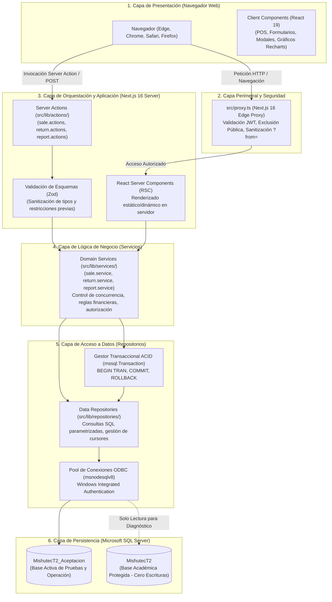
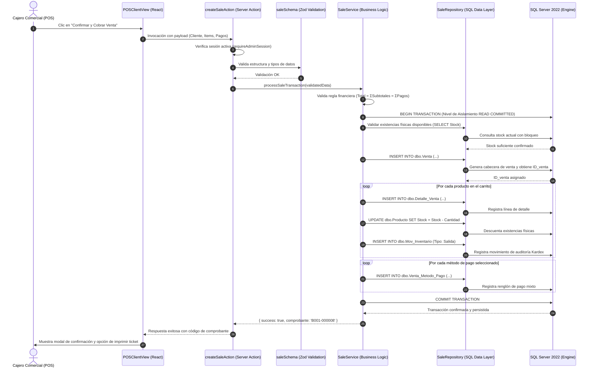

# ARQUITECTURA DE SOFTWARE Y FLUJO DE DATOS
## Sistema de Gestión Comercial MISHUTEC (Next.js 16 & SQL Server 2022)

**Paradigma:** Arquitectura por Capas Desacopladas (Clean Layered Architecture)  
**Framework Frontend/Backend:** Next.js 16 (React 19, Server Components, Server Actions)  
**Motor de Persistencia:** Microsoft SQL Server 2022 Express con Transacciones ACID  
**Autenticación y Seguridad:** JWT (HS256, \`jose\`), Cookies \`HttpOnly\`, Next.js 16 Edge Proxy (\`src/proxy.ts\`)

---

## 1. DIAGRAMA GENERAL DE ARQUITECTURA POR CAPAS

La arquitectura de Mishutec divide rigurosamente las responsabilidades del sistema en capas independientes, evitando que la interfaz web acceda directamente al motor de base de datos o que la lógica de negocio resulte acoplada al framework visual:

---

## 2. DESCRIPCIÓN DE LAS CAPAS Y RESPONSABILIDADES

### 2.1 Capa de Presentación (Client Components y React Server Components)
* **React Server Components (RSC):** Utilizados por defecto en las páginas de consulta (\`/dashboard\`, \`/productos\`, \`/inventario\`, \`/clientes\`, \`/proveedores\`, \`/empleados\`, \`/ventas\`, \`/devoluciones\`, \`/reportes\`). Obtienen los datos directamente en el servidor sin serializar APIs intermedias innecesarias ni exponer consultas al navegador.
* **Client Components (\`"use client"\`):** Empleados exclusivamente donde se requiere reactividad e interacción en tiempo real:
  - Punto de Venta (\`POSClientView.tsx\`): Gestión de carrito en memoria, cálculo reactivo de vuelto y selección de pagos mixtos.
  - Modales de Registro y Edición: Formularios con validación en tiempo real y feedback visual.
  - Tableros Analíticos con Recharts (\`SalesAnalyticsTab.tsx\`, \`ReturnsAnalyticsTab.tsx\`): Renderizado de gráficos interactivos de barras, líneas y sectores.

### 2.2 Capa Perimetral y Protección de Rutas (\`src/proxy.ts\`)
Next.js 16 introdujo una renovación arquitectónica formalizando \`src/proxy.ts\` en sustitución del antiguo archivo \`middleware.ts\`. En Mishutec, este archivo actúa como un firewall perimetral:
1. **Inspección de Sesión:** Intercepta cada solicitud entrante hacia las 9 rutas comerciales y hacia la ruta de diagnóstico técnico (\`/diagnostico\`).
2. **Extracción y Validación de Token:** Lee la cookie cifrada \`mishutec_session\`. Si no existe o su firma JWT es inválida, aborta la petición y redirige con código HTTP 307 hacia \`/login?from={path}\`.
3. **Inmunidad contra Open Redirect (CWE-601):** Limpia el parámetro \`?from=\` utilizando la función \`sanitizeRedirectUrl\`, garantizando que únicamente se acepten rutas relativas internas iniciadas con un solo \`/\`, bloqueando dominios de phishing externos (\`https://evil.com\`, \`//evil.com\`, etc.).

### 2.3 Capa de Orquestación y Server Actions (\`src/lib/actions/\`)
Las Server Actions proporcionan RPCs (Remote Procedure Calls) seguras entre el navegador y el servidor:
* No requieren configurar controladores REST tradicionales ni serializaciones manuales.
* Incorporan verificación previa de sesión (\`requireAdminSession\`) y validación de esquemas tipados mediante la librería **Zod**.
* Retornan estructuras uniformes: \`{ success: boolean; data?: T; error?: string; statusCode?: number }\`.

### 2.4 Capa de Lógica de Negocio y Servicios (\`src/lib/services/\`)
Centraliza las reglas operativas, cálculos financieros y políticas del negocio:
* **Garantía de Conciliación:** Verifica que el total de líneas de detalle coincida exactamente con la sumatoria de pagos recibidos antes de intentar persistir una venta.
* **Aislamiento de Garantías RMA:** Aplica la directriz que impide reingresar automáticamente componentes averiados al stock comercial.
* **Enmascaramiento de Datos Personales:** Aplica filtros conforme a la Ley N° 29733 de Protección de Datos Personales para DNI, correos y teléfonos.

### 2.5 Capa de Acceso a Datos y Repositorios (\`src/lib/repositories/\`)
Aísla por completo el código SQL del resto de la aplicación:
* **Consultas Parametrizadas Estrictas:** Todas las sentencias utilizan \`request.input('param', sql.Type, value)\`, erradicando cualquier vector de Inyección SQL (CWE-89).
* **Gestión de Transacciones ACID:** Para operaciones complejas (ej. registro de venta con descuento de stock y pagos), el servicio abre una transacción física (\`new sql.Transaction(pool)\`), ejecuta las operaciones dentro de un bloque \`try/catch\` y realiza \`await transaction.commit()\` o \`await transaction.rollback()\` si ocurre cualquier anomalía.

### 2.6 Conectividad y Pool de Conexiones (\`src/lib/db.ts\`)
* Emplea el driver nativo de alto rendimiento \`msnodesqlv8\` integrado con la biblioteca \`mssql\`.
* Se conecta mediante **Windows Integrated Authentication** (\`Trusted_Connection=yes\`), sin necesidad de almacenar contraseñas en texto plano en cadenas de conexión.
* Gestiona un pool singleton de conexiones que reutiliza sockets TCP/IP y conexiones ODBC, optimizando el rendimiento y evitando el agotamiento de puertos bajo cargas concurrentes.

---

## 3. CICLO DE VIDA COMPLETO DE UNA TRANSACCIÓN (CASO: VENTA POS)

La siguiente secuencia ilustra el recorrido exacto de los datos cuando un cajero comercial procesa una venta en el Punto de Venta:

---

## 4. JUSTIFICACIÓN ARQUITECTÓNICA DE LA SEPARACIÓN DE RESPONSABILIDADES

La elección de una **Arquitectura en Capas Desacopladas** frente a un modelo monolítico o consultas directas desde componentes responde a estrictos criterios de calidad de software e ingeniería de sistemas:

1. **Mantenibilidad y Evolución:** Si las reglas tributarias de comprobantes cambian en el futuro (ej. integración con factura electrónica SUNAT), únicamente se modifica la capa de servicios (\`SaleService\`), permaneciendo intactos los componentes visuales y las tablas de base de datos.
2. **Seguridad en Profundidad (Defense in Depth):** La seguridad no descansa únicamente en la interfaz visual. Aunque un atacante intente realizar un POST directo burlando el navegador, la petición es interceptada primero por el proxy, luego por la validación Zod en la Server Action, y finalmente por la autorización en el servicio.
3. **Auditabilidad y Trazabilidad Transaccional:** Cada operación de escritura pasa por un punto centralizado donde se audita el empleado responsable y se genera el movimiento Kardex complementario, erradicando modificaciones clandestinas o descontroladas del inventario.
4. **Independencia del Motor:** La lógica de persistencia encapsulada en repositorios facilita la optimización de consultas, ajuste de índices o migración futura de procedimientos almacenados sin alterar la experiencia de usuario.
