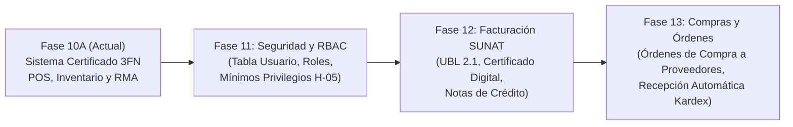

# LIMITACIONES DEL SISTEMA Y TRABAJO FUTURO
## Análisis de Brechas Técnicas, Gobierno de Riesgos y Hoja de Ruta — MISHUTEC

**Sistema:** MISHUTEC (Tienda de Componentes de Cómputo)  
**Versión de Evaluación:** 1.0 (Fase 10A - Cierre de Auditoría)  
**Propósito:** Transparencia académica y profesional respecto al alcance implementado frente al entorno de producción industrial.

---

## 1. GOBIERNO DE RIESGO DE INFRAESTRUCTURA (HALLAZGO H-05)

> [!WARNING]
> **CLASIFICACIÓN FORMAL DE SEGURIDAD (H-05):**  
> **"RIESGO DOCUMENTADO — MITIGACIÓN DE INFRAESTRUCTURA PENDIENTE"**

### 1.1 Diagnóstico del Hallazgo
En el entorno actual de desarrollo y auditoría, el pool de conexiones de Node.js (\`msnodesqlv8\`) se autentica contra Microsoft SQL Server Express mediante **Windows Integrated Authentication** utilizando la cuenta local del sistema operativo:
\`\`\`
Server: DESKTOP-QV4VK5K\SQLEXPRESS
Database: MishutecT2_Aceptacion
Windows User: DESKTOP-QV4VK5K\USER (Rol: sysadmin / db_owner)
\`\`\`
Esta cuenta posee privilegios elevados a nivel del motor de base de datos.

### 1.2 Justificación de la No-Intervención en Fases Previas
Las restricciones imperativas del proyecto prohibieron estrictamente alterar las cuentas de servicio de Windows o reconfigurar la seguridad de la instancia durante las fases de validación funcional, con el objetivo de preservar la estabilidad del entorno y evitar bloqueos en el runtime de Node.js.

### 1.3 Mitigaciones de Aplicación Implementadas
1. **Inyección SQL Erradicada:** El 100% de las consultas ejecutadas por los repositorios utilizan parámetros fuertemente tipados (\`request.input()\`). No existe ninguna consulta construida mediante concatenación dinámica.
2. **Defensa Perimetral:** Acceso condicionado por el proxy de Next.js 16 (\`src/proxy.ts\`) y verificación de sesión en Server Actions.

### 1.4 Hoja de Ruta de Mitigación en Despliegue Físico
Para el pase a un servidor de producción dedicado, se ejecutará el siguiente script de mínimos privilegios en SQL Server:
\`\`\`sql
-- 1. Crear login y usuario dedicado de mínimos privilegios
CREATE LOGIN usr_mishutec_app WITH PASSWORD = 'PasswordComplejo2026*!', CHECK_POLICY = ON;
USE MishutecT2_Aceptacion;
CREATE USER usr_mishutec_app FOR LOGIN usr_mishutec_app;

-- 2. Conceder exclusivamente permisos DML sobre tablas operativas
GRANT SELECT, INSERT, UPDATE ON SCHEMA::dbo TO usr_mishutec_app;

-- 3. Denegar explícitamente operaciones destructivas y DDL
DENY DELETE ON dbo.Venta TO usr_mishutec_app;
DENY DELETE ON dbo.Mov_Inventario TO usr_mishutec_app;
DENY ALTER, DROP TO usr_mishutec_app;
\`\`\`

---

## 2. LIMITACIONES TÉCNICAS Y OPERATIVAS ACTUALES

A continuación se detallan las limitaciones funcionales del sistema en su estado actual:

### 2.1 Ausencia de Facturación Electrónica SUNAT
* **Situación:** Los comprobantes emitidos (\`B001-XXXXXX\` y \`F001-XXXXXX\`) son comprobantes comerciales internos para control contable y administrativo de la tienda.
* **Limitación:** El sistema no genera archivos XML bajo el estándar UBL 2.1, no firma digitalmente los comprobantes con certificado digital tributario ni se comunica mediante servicios web SOAP con la Superintendencia Nacional de Aduanas y de Administración Tributaria (SUNAT).

### 2.2 Política de No Reembolso Monetario
* **Situación:** La tabla \`dbo.Devolucion\` administra el expediente técnico de garantía.
* **Limitación:** El sistema no cuenta con una tabla de *Notas de Crédito* ni registra egresos de dinero en efectivo en la caja. Las aprobaciones de garantía reconocen el derecho del cliente para reposición física o canje técnico, manteniendo inalterado el total facturado en la venta original (S/ 5,500.00).

### 2.3 Garantía Histórica en Línea de Venta
* **Situación:** El plazo de garantía de un producto se almacena en \`dbo.Producto.Garantia_meses\`.
* **Limitación:** La tabla \`dbo.Detalle_Venta\` no incluye una columna \`Garantia_meses_historica\`. Si el fabricante modifica el plazo de garantía de un producto en el catálogo futuro (ej. de 36 a 24 meses), las ventas pasadas que consulten dinámicamente la tabla \`Producto\` reflejarán el valor actual en lugar del plazo ofrecido en la fecha de compra.

### 2.4 Trazabilidad Indirecta entre Kardex y Ventas/Devoluciones
* **Situación:** La tabla \`dbo.Mov_Inventario\` registra salidas por venta y entradas por reingreso con fecha, cantidad y empleado.
* **Limitación:** El esquema físico de la base de datos no dispone de claves foráneas directas (\`ID_venta\`, \`ID_devolucion\`) dentro de \`Mov_Inventario\`. La asociación entre un movimiento de inventario y la venta que lo originó se realiza por correlación cronológica, empleado y producto, pero no mediante restricción referencial física.

### 2.5 Autenticación Administrativa Local vs Sistema Multi-Rol (RBAC)
* **Situación:** El acceso al sistema se realiza mediante una credencial administrativa única configurada por variables de entorno y verificada con scrypt y JWT.
* **Limitación:** El esquema de base de datos no contiene una tabla \`dbo.Usuario\` ni un modelo de control de acceso basado en roles (RBAC) con permisos diferenciados entre cajeros, jefes de almacén, auditores contables y administradores generales.

---

## 3. HOJA DE RUTA Y TRABAJO FUTURO (ROADMAP)

Para futuras versiones de Mishutec, se propone la siguiente planificación modular:

1. **Implementación de RBAC en Base de Datos (Fase 11):**
   - Creación de tablas \`dbo.Usuario\`, \`dbo.Rol\` y \`dbo.Permiso\`.
   - Asignación de credenciales individuales para cada cajero y almacenista con registro de auditoría en cada transacción.
   - Mitigación física de H-05 mediante usuario de SQL Server con permisos restringidos.
2. **Integración con Facturación Electrónica SUNAT (Fase 12):**
   - Generación de comprobantes XML firmados con certificado digital.
   - Integración con OSE (Operador de Servicios Electrónicos) o SUNAT.
   - Incorporación formal de Notas de Crédito y Notas de Débito electrónicas.
3. **Módulo Completo de Abastecimiento y Compras (Fase 13):**
   - Incorporación de tablas \`dbo.Orden_Compra\` y \`dbo.Detalle_Orden_Compra\`.
   - Generación automática de movimientos de Kardex tipo 'Entrada' al confirmar la recepción física de mercancía desde distribuidores mayoristas.
