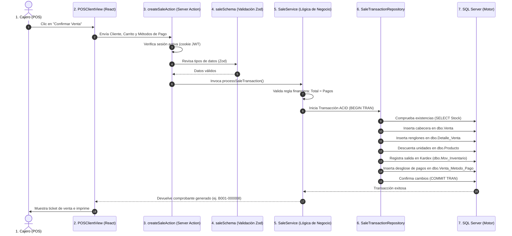

# 👥 GUION DE ESTUDIO Y EXPOSICIÓN EN EQUIPO: MISHUTEC
## Explicación Didáctica Archivo por Archivo, Carpeta por Carpeta y Flujo Transaccional

> **Propósito:** Esta guía está escrita en lenguaje claro y directo para que tú y tus compañeros de equipo entiendan de inicio a fin qué hace cada archivo del proyecto, cómo interactúan entre sí y cómo explicarlo frente al docente o jurado sin titubear.

---

## 🎯 1. LA INTRODUCCIÓN RÁPIDA (Para que el equipo rompa el hielo)

> *"Mishutec es un sistema de gestión comercial, inventario y punto de venta para una tienda de hardware y ensamblaje de computadoras. No es una simple página web con datos falsos: está conectado a una base de datos real en Microsoft SQL Server con 25 tablas físicas normalizadas en Tercera Forma Normal (3FN), y la aplicación web está hecha con Next.js 16, React 19 y TypeScript usando una arquitectura profesional por capas desacopladas."*

### Los 3 problemas reales que resuelve el sistema:
1. **Cero descuadre de inventario:** El stock físico se calcula y audita con un **Kardex** automático (Entradas - Salidas = Stock actual).
2. **Cero descuadre en caja:** Soporta **pagos mixtos** (efectivo, tarjeta, transferencias, Yape/Plin), asegurando que el total facturado sea idéntico a la suma de pagos recibidos.
3. **Gestión real de garantías (RMA):** Si un cliente devuelve un producto averiado, el sistema no lo regresa al stock vendible; solo reingresa si viene en empaque sellado sin abrir.

---

## 📂 2. RADIOGRAFÍA COMPLETA: QUÉ HACE CADA CARPETA Y ARCHIVO

### ⚙️ A. Archivos de Configuración en la Raíz

| Archivo | ¿Qué es y qué hace? | ¿Cómo explicarlo? |
| :--- | :--- | :--- |
| **`package.json`** | El manifiesto de Node.js / npm. Define el nombre del proyecto (`mishutec`), scripts de ejecución (`dev`, `build`, `db:test`, `test:9c`) y todas las librerías instaladas (`next 16`, `react 19`, `mssql`, `msnodesqlv8`, `zod`, `recharts`, `lucide-react`). | *"Es la lista de compras del proyecto; aquí se declaran las tecnologías y los comandos que usamos para correr y probar la app."* |
| **`package-lock.json`** | Registro con las versiones exactas y checksums de todas las dependencias instaladas. | *"Garantiza que el proyecto instale exactamente las mismas librerías en cualquier computadora sin romperse."* |
| **`.env.local`** | Archivo privado de variables de entorno. Contiene el nombre del servidor SQL (`localhost\SQLEXPRESS01`), la base de datos activa (`MishutecT2_Aceptacion`), el hash de la contraseña de admin y la clave secreta de sesión JWT. | *"Es la configuración secreta de nuestra máquina; aquí le decimos a Next.js a qué servidor SQL conectarse."* |
| **`.env.example`** | Plantilla de ejemplo sin contraseñas reales. Sirve de guía para saber qué variables necesita el sistema al clonarlo. | *"Es la plantilla para que cualquier otro desarrollador sepa qué variables debe configurar."* |
| **`tsconfig.json`** | Configuración del compilador de TypeScript. Activa el modo estricto (`strict: true`) y configura alias de rutas como `@/*` para importar archivos limpiamente desde `src/`. | *"Le dice a TypeScript qué tan estricto debe ser revisando el código para evitar errores de tipos."* |
| **`next.config.ts`** | Archivo de configuración oficial de Next.js. Aquí se configuran optimizaciones de compilación (Turbopack, headers, etc.). | *"Ajusta las opciones avanzadas del framework web."* |
| **`eslint.config.mjs`** | Reglas de control de calidad y estilo de código con ESLint 9. | *"Revisa que sigamos buenas prácticas de programación y no dejemos variables huérfanas."* |
| **`.gitignore`** | Lista de carpetas y archivos que no deben subirse a Git (como `node_modules/`, `.next/`, y archivos `.env.local`). | *"Evita subir archivos pesados o contraseñas privadas al repositorio."* |
| **`README.md`** | Guía introductoria básica con instrucciones para ejecutar `npm run dev`. | *"Es el manual de bienvenida con los comandos de arranque rápido."* |

---

### 💻 B. La Carpeta `src/` (El Código Fuente de la Aplicación)

La carpeta `src` contiene todo el desarrollo del sistema y está dividida en cuatro subcarpetas fundamentales:

```
src/
├── app/          -> Rutas, pantallas visuales y el proxy perimetral
├── components/   -> Bloques visuales reutilizables (Sidebar, Modales, POS)
├── lib/          -> Lógica de negocio, base de datos, seguridad y servicios
└── types/        -> Definición de modelos e interfaces de TypeScript
```

---

#### 1. `src/app/` (Enrutamiento con App Router)
Next.js 16 usa enrutamiento basado en carpetas. Cada carpeta con un archivo `page.tsx` se convierte automáticamente en una URL en el navegador:

* **`src/proxy.ts`** *(¡Archivo clave de seguridad!)*:
  * **Qué hace:** En Next.js 16 reemplaza al antiguo `middleware.ts`. Es un **firewall perimetral** que intercepta cada visita a las rutas protegidas.
  * **Cómo explicarlo:** *"Antes de que el usuario vea cualquier pantalla, `proxy.ts` revisa la cookie con el token JWT. Si no estás logueado, te manda al login. Además, limpia la URL para evitar ataques de redirección abierta (CWE-601)."*
* **`layout.tsx`**: Define el esqueleto HTML general, fuentes tipográficas (`Geist`) e idioma del sitio.
* **`page.tsx`**: Página de bienvenida o redirección inicial al entrar a `http://localhost:3000`.
* **`login/page.tsx`** y **`login/LoginForm.tsx`**: Pantalla y formulario cliente de autenticación con campos para usuario, contraseña y mensajes de error reactivos.
* **`diagnostico/page.tsx`**: Una pantalla técnica interactiva en vivo que muestra el estado de la conexión a SQL Server, la latencia en milisegundos, el usuario de Windows autenticado y la versión del motor de base de datos.
* **`api/db-status/route.ts`**: Endpoint API tipo REST que responde en formato JSON (`{"status": "healthy"}`) para verificar si la base de datos está online.
* **`api/products/[barcode]/route.ts`**: Endpoint de búsqueda rápida por código de barras que usa la pistola de escaneo en la caja.
* **`(admin)/`** *(Grupo de rutas privadas con menú lateral)*:
  * **`layout.tsx`**: Renderiza la barra lateral (`Sidebar`) común a todos los módulos comerciales.
  * **`dashboard/page.tsx`**: Panel principal con métricas clave (KPIs de ventas del día, monto recaudado, alertas de stock mínimo y gráficos).
  * **`productos/page.tsx`**: Catálogo comercial de componentes con filtros por categoría, marca y búsqueda por nombre o código de barras.
  * **`inventario/page.tsx`**: Pantalla de control de existencias físicas y visualización completa del **Kardex** (31 movimientos de entradas y salidas auditadas).
  * **`ventas/page.tsx`**: La terminal de Punto de Venta (POS). Permite agregar productos al carrito, escanear códigos, calcular vuelto y cobrar con múltiples métodos de pago a la vez.
  * **`clientes/page.tsx`**: Registro de clientes con **enmascaramiento de datos personales** (muestra `72****90` para cumplir con la Ley N° 29733 de Protección de Datos Personales).
  * **`proveedores/page.tsx`**: Catálogo de distribuidores y mayoristas asociados mediante la tabla `Suministra`.
  * **`empleados/page.tsx`**: Directorio del personal comercial y cajeros responsables de las operaciones.
  * **`devoluciones/page.tsx`**: Módulo de garantías y devoluciones que aplica la política técnica de restock.
  * **`reportes/page.tsx`**: Informes analíticos avanzados con gráficos interactivos desarrollados con la librería **Recharts**.

---

#### 2. `src/components/` (Componentes Visuales de Interfaz)
Aquí se colocan los componentes visuales que se repiten en el sistema para no duplicar código:
* **`layout/`**: Contiene el `Sidebar.tsx` (menú de navegación con íconos de Lucide) y el `Header.tsx`.
* **`pos/`**: Vistas especializadas del punto de venta (`POSClientView.tsx`, teclado numérico, resumen del carrito en memoria).
* **`modals/`**: Ventanas modales para crear productos, registrar clientes y confirmar ventas.
* **`ui/`**: Botones, tablas dinámicas, tarjetas de KPI y badges de colores (verde para *Disponible*, rojo para *Agotado*).

---

#### 3. `src/lib/` (El Corazón: Arquitectura por Capas Desacopladas)
Aquí reside la verdadera ingeniería del software. Para no mezclar la interfaz con la base de datos, el código se divide en capas:

$$\text{Pantalla (UI)} \longrightarrow \text{Actions} \longrightarrow \text{Validations (Zod)} \longrightarrow \text{Services} \longrightarrow \text{Repositories} \longrightarrow \text{SQL Server}$$

* **`db.ts`**:
  * Gestiona la conexión con SQL Server usando el controlador nativo de alto rendimiento `msnodesqlv8`.
  * Usa autenticación integrada de Windows (`Trusted_Connection=yes`), por lo que no hay claves de base de datos expuestas en el código.
  * Implementa el patrón **Singleton**: crea un pool de conexiones reutilizable para no saturar los puertos de la máquina.
* **`db-guard.ts`**:
  * Un protector de seguridad estricto. Si detecta que la base de datos configurada es la base académica original `MishutecT2`, **bloquea cualquier intento de inserción o modificación** (`AcademicDatabaseProtectedError`), garantizando que la información del docente quede 100% protegida.
* **`formatters.ts`**:
  * Funciones para formatear dinero en soles peruanos (`S/. 1,450.00`), fechas legibles y enmascarar DNIs y correos.
* **`utils.ts`**:
  * Contiene la función auxiliar `cn()` que combina clases CSS de Tailwind de forma limpia y sin conflictos.
* **`auth/`**:
  * `session.ts`: Emite y verifica tokens JWT con algoritmo HS256 guardados en cookies `HttpOnly` imposibles de robar mediante JavaScript.
  * `password.ts`: Genera y verifica contraseñas usando el algoritmo criptográfico PBKDF2 con salting.
  * `redirect.ts`: Función `sanitizeRedirectUrl` que desinfecta las URLs para que nadie pueda ser redirigido a una página de phishing externa.
* **`validations/` (Esquemas Zod)**:
  * Archivos: `sale.schema.ts`, `return.schema.ts`, `product-mutation.schema.ts`, etc.
  * **Qué hacen:** Definen exactamente qué tipo de datos debe enviar el usuario (ej: que el precio sea mayor a cero, que la cantidad sea un entero positivo, que el DNI tenga 8 dígitos). Si los datos están mal, Zod los rechaza antes de tocar la base de datos.
* **`services/` (Lógica de Negocio)**:
  * Archivos: `sale.service.ts`, `return.service.ts`, `inventory.service.ts`, `report.service.ts`, etc.
  * **Qué hacen:** Aplican las reglas de la empresa. Por ejemplo, en `sale.service.ts` se valida la regla de oro:
    $$\text{Monto Total} = \sum(\text{Detalle de productos}) = \sum(\text{Abonos en efectivo, tarjeta o Yape})$$
    Si sobra o falta un solo céntimo, la venta se aborta.
* **`repositories/` (Capa de Acceso a Datos SQL)**:
  * Archivos: `sale-transaction.repository.ts`, `product.repository.ts`, `return-transaction.repository.ts`, etc.
  * **Qué hacen:** Son los únicos archivos que contienen código SQL.
  * **Características clave:**
    1. **100% Parametrizadas:** Usan `request.input('id', sql.Int, id)` para que sea matemáticamente imposible recibir un ataque de Inyección SQL.
    2. **Transacciones ACID:** Utilizan `new sql.Transaction()` con `BEGIN TRAN`, `COMMIT` y `ROLLBACK`. Si se descuenta el stock pero falla el registro del cobro, todo se cancela de forma automática sin dejar datos corruptos.
* **`actions/` (Server Actions)**:
  * Archivos: `sale.actions.ts`, `return.actions.ts`, `product.actions.ts`, etc.
  * **Qué hacen:** Funciones seguras que React llama directamente desde los botones de la pantalla sin necesidad de crear endpoints REST manuales.

---

#### 4. `src/types/` (Tipado TypeScript)
* Archivos: `sales.ts`, `inventory.ts`, `product.ts`, `returns.ts`, `reports.ts`, `entities.ts`.
* **Qué hacen:** Contienen las interfaces de TypeScript que reflejan las tablas y objetos del sistema. Si alguien escribe un campo con una letra equivocada, TypeScript avisa al instante y evita que el sistema falle en ejecución.

---

### 📚 C. La Carpeta `docs/` (Documentación y Base de Datos)

Esta carpeta es la evidencia formal de ingeniería del proyecto:
* **`FinalFinalisisimo.sql`**: El script SQL maestro con el código DDL y DML completo: creación de las 25 tablas, claves primarias compuestas, claves foráneas, restricciones `CHECK`, índices y datos iniciales.
* **`PROYECTO_FINAL.pdf`**: El documento y diapositivas oficiales del curso con la justificación del problema, diagramas de flujo y arquitectura.
* **`PROCEDIMIENTO_RESPALDO_ACEPTACION.md`**: Guía técnica que documenta cómo se clonó de forma segura la base de datos `MishutecT2` hacia `MishutecT2_Aceptacion`.
* **`schema-metadata.json`**: Extracción en formato JSON de la estructura completa de las tablas y columnas.
* **`sustentacion/`** *(Documentos específicos para defender el proyecto)*:
  * **`01-informe-tecnico-academico.md`**: Informe técnico completo del proyecto.
  * **`02-diccionario-de-datos-25-tablas.md`**: Detalle campo por campo de cada una de las 25 tablas físicas.
  * **`03-modelo-entidad-relacion.md`**: Explicación del modelo relacional, entidades fuertes, débiles y supertipo/subtipo.
  * **`04-arquitectura-del-sistema.md`**: Explicación detallada de la arquitectura por capas y diagramas de flujo.
  * **`05-matriz-de-trazabilidad.md`**: Demuestra cómo cada requerimiento del negocio se cumple en una tabla y en una pantalla.
  * **`06-consultas-sql-defensa.sql`** y **`.md`**: Las consultas complejas (JOINs múltiples, subconsultas correlacionadas, agrupaciones y conciliaciones) preparadas para ejecutar en vivo en SQL Server si el jurado pide pruebas.
  * **`08-guion-de-sustentacion.md`**: Cronograma minuto a minuto de la exposición.
  * **`09-banco-preguntas-defensa.md`**: Banco de 20 preguntas difíciles que suele hacer un docente y cómo responderlas técnicamente.

---

### 🧪 D. La Carpeta `scripts/` (Herramientas y Pruebas Automatizadas)

Contiene programas en TypeScript y SQL diseñados para correr por consola y certificar que todo funcione:
* **`test-db-connection.ts`**: Prueba de fuego de la base de datos. Se ejecuta con `npm run db:test` para verificar que SQL Server responda y que las tablas tengan sus registros.
* **`backup-and-create-aceptacion.sql`** y **`execute-acceptance-setup.ts`**: Automatizan la creación de la base de aceptación mediante comandos nativos `BACKUP` y `RESTORE ... WITH MOVE`.
* **`verify-databases-status.ts`**: Compara simultáneamente la base académica y la base de aceptación para demostrar que la base original sigue virgen y protegida.
* **`test-phase6b-transactions.ts`** a **`test-phase9c-e2e.ts`**: Baterías de pruebas automatizadas (73 pruebas en total) que simulan ventas, compras, devoluciones y ataques de seguridad, certificando que el sistema tiene un 100% de éxito.

---

## 🔄 3. EL EJEMPLO DE ORO: CÓMO VIAJAN LOS DATOS EN UNA VENTA

Si el profesor o un compañero les dice: *"Explíquenme qué pasa cuando hago clic en 'Cobrar' en el Punto de Venta"*, esta es la respuesta perfecta:



---

## 🎭 4. REPARTO DE ROLES SUGERIDO PARA EL EQUIPO

Para que todos los integrantes participen de forma equilibrada y destaquen ante el jurado:

### 👤 Integrante 1: Problemática, Negocio y Demostración Web
* **Qué expone:** La introducción del problema de la tienda, por qué se hizo el sistema y el recorrido por las pantallas (`app/(admin)`: Dashboard, Productos, Inventario y el Punto de Venta en vivo).
* **Conceptos clave:** Kardex de inventario, punto de venta amigable, cobros mixtos y políticas de garantía.

### 👤 Integrante 2: Arquitectura de Software, Código y Seguridad
* **Qué expone:** La carpeta `src/lib`, el flujo de Server Actions hacia Servicios y Repositorios, la validación con Zod y la seguridad perimetral (`proxy.ts` con JWT y sanitización contra Open Redirect).
* **Conceptos clave:** Clean Layered Architecture, transacciones atómicas ACID (`BEGIN`, `COMMIT`, `ROLLBACK`), consultas parametrizadas contra Inyección SQL y enmascaramiento de datos personales.

### 👤 Integrante 3: Base de Datos Relacional y Consultas SQL
* **Qué expone:** El script `FinalFinalisisimo.sql`, la estructura de las 25 tablas en SQL Server, la normalización en 3FN, la herencia supertipo/subtipo de hardware y ejecuta 1 o 2 consultas en vivo desde `06-consultas-sql-defensa.sql` (como la conciliación financiera triple).
* **Conceptos clave:** Claves primarias compuestas (`Suministra`), integridad referencial, restricciones `CHECK` y las 73 pruebas automatizadas de aceptación aprobadas al 100%.

---

> [!TIP]
> Pueden tener este documento abierto durante los repasos del grupo. Si se dividen los temas siguiendo este guion, la exposición fluirá de manera natural, profesional y muy sólida.
